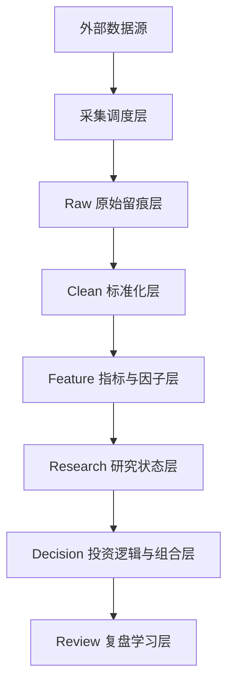

# ALIS 整体设计

## 1. 系统定位

ALIS 的目标是建设一个面向长线投资的研究型数据平台。它不把 K 线策略当作最终决策系统，而是把行情、财务、公告、行业、估值、组合和复盘连接成一条可追溯的研究链路。

核心原则：

- 数据先成为事实，不直接产生买入信号。
- 事实形成企业状态、行业状态、事件状态和风险状态。
- 状态服务于投资逻辑，而不是只服务于单一总分。
- 组合管理根据逻辑确定性、安全边际、风险和暴露决定仓位。
- 每次决策都保留当时的数据快照，避免复盘被后来修订的数据污染。

## 2. 分层架构



### 外部数据源

- Tushare API：股票基础、行情、估值、财务、股东、指数等结构化数据。
- 交易所和巨潮：公告、定期报告、监管函、业绩预告等正式披露。
- 网页爬虫：行业数据、因子页面、公开资料和补充字段。
- 手工导入：早期行业指标和高价值低频数据允许 CSV/JSON 导入。

### Raw 原始留痕层

所有关键接口返回结果都先保存原始记录，包含：

- `source`
- `api_name`
- `params`
- `payload`
- `trade_date` / `period`
- `available_time`
- `ingestion_time`

这样可以追溯“当时系统到底看到了什么”。

### Clean 标准化层

把外部字段统一成内部语义，例如股票代码、交易日期、报告期、公告发布时间、指标名称和数据类型。

### Feature 指标与因子层

负责计算：

- 企业质量
- 成长能力
- 现金流质量
- 偿债安全
- 股东回报
- 估值分位
- 行业景气
- 公告事件影响
- 风险信号

### Research 研究状态层

输出多维状态，而不是单一分数：

```text
quality_score
growth_score
cashflow_score
industry_score
expectation_score
valuation_score
governance_score
risk_score
```

系统应能区分“高质量但过贵”“低估但质量一般”“景气反转”“治理风险恶化”等不同投资含义。

### Decision 投资逻辑与组合层

长期目标是建立投资逻辑卡片：

```json
{
  "stock_code": "000001.SZ",
  "thesis_type": "quality_growth",
  "hypotheses": [
    {
      "hypothesis": "收入保持稳定增长",
      "metric": "revenue_yoy",
      "expected_range": [0.10, 0.20],
      "failure_condition": "连续两个季度低于 5%"
    }
  ]
}
```

持仓不只回答“买不买”，还要持续回答“当初为什么买，现在这个理由是否仍然成立”。

## 3. 当前已实现的数据中台 V1

主系统 `quantification-main` 已经实现数据中台基础能力：

- `data_sources`：数据源登记。
- `data_ingestion_runs`：采集运行记录。
- `tushare_api_catalog`：Tushare API 目录和可用性。
- `dc_tushare_raw_records`：Tushare 原始记录留痕。
- `dc_stock_master`：股票基础信息。
- `dc_trade_calendar`：交易日历。
- `dc_stock_daily_snapshot`：股票每日快照。
- `dc_data_quality_checks`：数据质量检查结果。
- `dc_announcement_raw`：公告原文/元数据。
- `dc_announcement_event`：公告事件。
- `dc_industry_metric_definition`：行业指标定义。
- `dc_industry_metric_value`：行业指标值。

前端已经增加“数据中台”页面，用于查看覆盖率、API 目录、同步入口、运行记录和耗时估计。

## 4. 数据获取效率策略

当前最重要的性能方向不是引入更重的基础设施，而是采集策略优化。

### 全量初始化

全量初始化需要分批执行，优先顺序：

1. 股票基础和交易日历。
2. 最近交易日行情、估值、复权、涨跌停、资金流。
3. 最近 4 到 8 个报告期财务数据。
4. 股东、质押、分红、业绩预告。
5. 指数与行业基础数据。
6. 公告与行业指标。

财务类接口通常需要按 `ts_code + period` 拉取，应限制并发、记录断点，避免每天重复全量抓取。

### 日常增量

每天增量应只拉：

- 当日或最近交易日行情。
- 新增公告。
- 新披露财报或业绩预告。
- 新的股东/质押/分红/披露计划。
- 需要重算的股票快照和质量检查。

### 断点续跑

每个任务必须记录：

- 任务参数。
- 成功条数。
- 失败接口。
- 下一次续跑位置。
- 耗时。
- 错误信息。

这样失败后不需要从头开始。

## 5. 后续模块缺口

### 数据层

- PostgreSQL 迁移方案。
- Redis 队列和任务状态。
- MinIO 存储公告 PDF、HTML、研报和网页快照。
- Parquet 历史行情和因子归档。

### 采集层

- 公告抓取增强：交易所、巨潮、定期报告正文。
- 行业指标采集模板。
- 异步爬虫池、限速、重试和代理池。
- 统一任务队列。

### 研究层

- 行业化基本面评分模板。
- 预期变化引擎。
- 估值区间和安全边际。
- 公告事件结构化解析。
- 风险硬过滤和仓位限制规则。

### 投资层

- 投资逻辑卡片。
- 持仓状态机。
- 组合暴露和再平衡建议。
- 决策快照和复盘记录。

## 6. 推荐演进路线

### 阶段一：数据中台稳定化

- 完成增量同步、断点续跑、运行记录和质量检查。
- 把 Tushare、公告、行业指标都纳入统一运行记录。
- 明确每个 API 的可用性、耗时和失败原因。

### 阶段二：研究状态化

- 建立多维评分，不使用单一总分直接买入。
- 按行业建立财务模板。
- 接入公告事件和风险信号。

### 阶段三：投资逻辑引擎

- 建立买入逻辑、验证指标、失效条件。
- 每次数据更新自动检查逻辑是否加强、削弱或证伪。

### 阶段四：组合与复盘

- 建立仓位约束、行业暴露和持仓状态机。
- 每次买卖冻结决策快照。
- 复盘错误类型：数据错误、模型错误、估值错误、仓位错误、执行错误。
