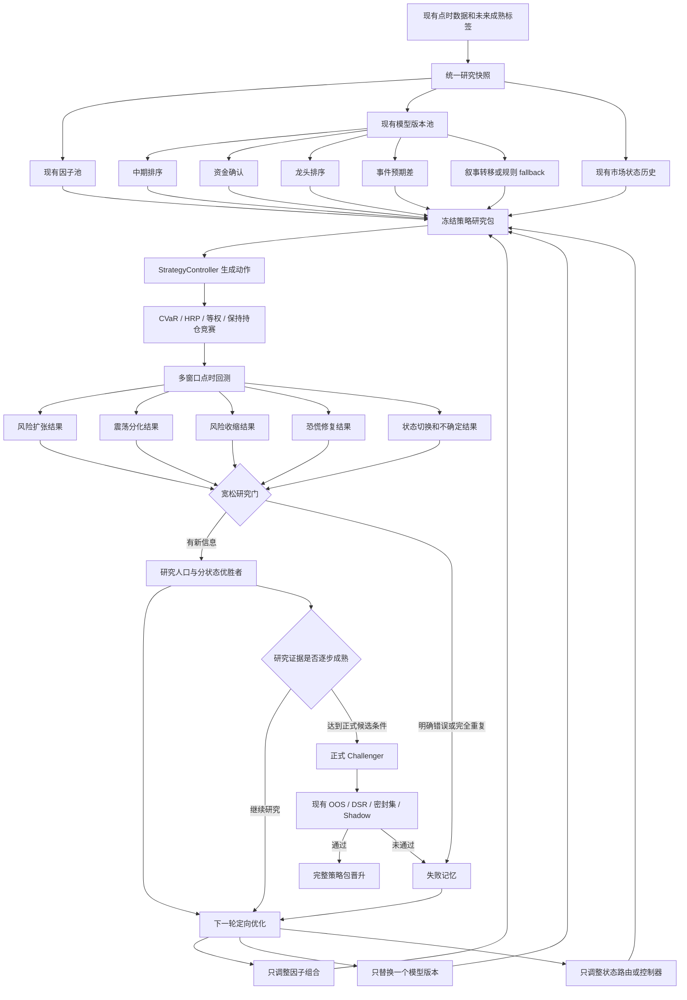

# 因子、模型与策略持续优化系统重构方案

## 1. 这次重构要解决什么

ALIS 现在已经有因子平台、模型训练、市场状态、策略回测、StrategyController、组合优化、正式 OOS、Shadow 和 Champion 晋升，但这些能力仍是几条相对独立的链路。

当前最主要的问题不是模型或因子数量不够，而是已有能力没有组成一个持续优化的研究系统：

- 因子组合研究主要调整因子集合和权重，没有把模型版本作为策略的一部分共同研究。
- 模型可以周期训练和生成 Challenger，但模型结果没有持续进入因子组合策略研究。
- 市场状态已经进入部分策略和回测，但没有成为所有候选统一的评价维度。
- 回测可能读取运行时当前激活模型，研究候选没有完整冻结模型版本束，前后结果可能不可比。
- 因子、模型、策略控制器和组合方法分别产生候选，缺少统一的研究基线、反馈和重新组合过程。
- 研究阶段的部分门控接近生产门，第一版效果不佳的候选容易过早退出研究。

本次重构的第一目标不是继续增加模型、因子或算法，而是把已有能力连接起来，先产出第一个可以长期持续优化的完整系统。

## 2. 第一版范围

### 2.1 第一版只使用现有能力

第一版使用：

- 当前统一因子注册表中的 active 和 candidate 因子。
- 当前市场状态体系：透明四状态机、HSMM Shadow 和 BOCPD 变点信号。
- 当前五个业务模型：中期排序、资金持续、龙头排序、事件预期差、叙事状态转移。
- 当前 StrategyController 动作合同。
- 当前经验 CVaR、等权、HRP 和保持持仓组合方案竞赛。
- 当前策略重放、正式 OOS、统计校正、密封集、未来 Shadow、晋升和回退链路。
- 当前 Evolution Worker、任务租约、断点恢复和资源预算。

### 2.2 第一版明确不做

- 不新增模型族。
- 不引入新的深度学习、强化学习或元模型。
- 不先扩展新的因子数据源和大规模因子发现空间。
- 不先建设复杂无监督聚簇算法。
- 不先建设合成行情生成器。
- 不让 LLM 生成可直接执行的模型、因子或策略代码。
- 不改变正式交易、账本和安全约束。
- 不让研究结果直接覆盖 Champion。

已有开放因子发现可以保留，但在第一版闭环完成前不作为主要研究资源消费者。先把当前因子和模型用好，再决定是否扩大搜索空间。

## 3. 正确的研究对象

研究对象不能再只是“几个因子及其权重”。一个完整策略候选必须冻结为一个策略研究包：

```text
策略研究包
= 数据截止与点时合同
+ 因子集合、方向、权重和版本
+ 五个业务模型的明确版本束
+ 市场状态模型与状态路由版本
+ StrategyController 版本
+ 组合方法和风险预算
+ 调仓频率、持有期和换手参数
+ 成本、基准和交易约束
```

策略研究包必须有稳定哈希。任何一个因子版本、模型版本、市场状态规则、控制器参数或成本合同变化，都应形成新的研究包，不能沿用旧结果。

回测必须显式接收这个研究包，禁止在研究过程中隐式读取“当前 active 模型”。这样才能回答：

- 是因子组合改善了结果，还是模型版本变化造成的？
- 某个模型在哪类市场有效？
- 模型和因子组合后是否互相增强或互相抵消？
- 同一候选在不同时间重放时是否仍是同一个候选？

## 4. 现有模型如何配合

第一版不把所有模型简单加权成一个总分。每个模型负责一个明确问题，按职责串成策略链。

| 现有能力 | 第一版职责 | 主要输出 | 在策略中的作用 |
|---|---|---|---|
| 透明四状态机 + HSMM Shadow + BOCPD | 识别市场环境和切换风险 | 状态、置信度、状态概率、变点风险 | 决定使用哪套因子/模型权重和风险预算 |
| `medium_horizon_lambdarank_v1` | 判断中期相对收益 | 排名、20 日正超额概率 | 作为股票基础排序和预期收益主来源 |
| `capital_persistence_multitask_v1` | 判断资金是否确认 | 方向概率、幅度、持续期、下行情景 | 控制新增、加仓、减仓和预期收益可信度 |
| `leader_lambdarank_v1` | 判断行业或主题内龙头 | 组内排名、资金确认 | 决定同一主线优先选择谁及仓位上限 |
| `event_surprise_lgbm_v1` | 判断事件带来的额外收益 | 异常收益、正收益概率、半衰期 | 调整短期收益预期、持有期和退出条件 |
| `narrative_transition_multitask_v1` | 判断叙事生命周期 | 扩散、加速、分歧、降温、退潮概率 | 控制是否允许加仓以及何时减仓或退出 |
| StrategyController | 把研究信号变成动作 | 买入、加仓、减仓、退出、持有、防御切换 | 统一动作和退出合同 |
| CVaR / HRP / 等权 / 保持持仓 | 把动作变成目标权重 | 目标权重和风险贡献 | 比较成本、风险、换手后选择组合方案 |

### 4.1 市场状态模型

第一版继续使用透明四状态机作为生产基线，不等待 HSMM 正式接管后才开始闭环。HSMM 继续按现有训练与 Shadow 合同积累证据，并作为市场状态 Challenger 参与研究对照。

市场状态层负责：

- 给每个历史交易日生成点时状态。
- 区分风险扩张、震荡分化、风险收缩和恐慌修复。
- 提供状态置信度和 BOCPD 变点风险。
- 指示当前应使用的因子配比、模型配比和风险预算。
- 对状态不确定或快速切换单独留证。

第一版不假设 HSMM 一定优于透明规则。两者在同一策略包和同一历史窗口中比较，只有策略级结果改善后，HSMM 才有资格进入正式策略包。

### 4.2 中期排序模型

中期模型作为股票排序骨架，负责回答“未来一段时间哪些股票更值得持有”。它不是独立策略，也不单独决定买入。

第一版固定其职责：

- 提供基础横截面排序。
- 提供中期正超额概率。
- 向组合优化器提供预期收益主分量。
- 在扩张、震荡和收缩状态分别记录效果。

### 4.3 资金持续模型

资金模型负责确认中期、事件和叙事信号是否得到真实交易资金支持。

第一版继续使用现有硬门和降级合同：

- 资金底部分位禁止新增。
- 低确认不允许加仓。
- 生产模型健康降级时降低权重并撤销相应硬门。
- 资金持续期和下行情景参与持有与减仓判断。

资金模型不能单独制造买入，只能确认、削弱或否决其他收益来源。

### 4.4 龙头排序模型

龙头模型不与中期模型重复做全市场排序。它负责在已经合格的行业、主题或候选集合中选择更有代表性的标的。

第一版将其作用限制为：

- 同一主题或行业内部排序。
- 判断主线中的领先地位和可成交性。
- 对低龙头排名标的降权或限制仓位。
- 与中期模型意见冲突时保留冲突证据，不直接覆盖中期模型。

### 4.5 事件预期差模型

事件模型负责短周期额外收益，不替代中期持有逻辑。

第一版使用方式：

- 对已有候选增加或减少事件收益分量。
- 决定事件类机会的预期持有期。
- 事件半衰期结束或负面概率上升时触发退出检查。
- 在没有合格事件时保持中性，不把缺失事件当作负信号。

### 4.6 叙事状态转移模型

叙事监督模型当前尚未生产激活。第一版不等待它，也不新增替代模型：

- 当前继续使用确定性主题生命周期规则作为 fallback。
- 已有叙事模型候选继续按新数据和周期训练。
- 叙事模型版本可以进入研究策略包，但不能在未激活时被回测隐式当作生产模型。
- 只有策略级成本后结果优于规则 fallback，才继续走正式验证。

已有主题发现和确定性主题评分只作为叙事输入，不在第一版另建独立训练闭环。

### 4.7 `main` 通用模型和模型宪法

当前 `main` 通用模型没有激活版本，且其横截面排序职责与中期模型存在重合。第一版不恢复或扩展它，也不让它阻塞闭环。

Kalman、GARCH、CVaR 等现有模型宪法组件继续保留原有风险和估计职责，但不作为第一版独立搜索人口。第一版只优化已经进入决策链、职责清晰且有可回放输出的六个核心模型族。

## 5. 第一版模型协作流程



## 6. 第一版如何持续优化

第一版采用分层交替优化，不在一开始同时随机改变全部变量。原因是因子、五个模型、市场状态、控制器和组合参数全部同时变化会产生巨大组合空间，也无法解释收益变化来自哪里。

### 6.1 建立研究基线包

从当前 Champion 冻结一个只用于研究比较的基线包，包含：

- 当前选股策略和因子绑定。
- 当前可用的五个模型版本及 fallback 状态。
- 当前透明四状态机和 HSMM Shadow 对照版本。
- 当前 StrategyController。
- 当前组合优化、成本和执行合同。

研究基线包不是生产 Champion 的别名。生产版本变化不能自动改变已经冻结的研究基线。

### 6.2 三条交替优化通道

第一版只运行三类候选：

1. 因子通道：固定模型、市场状态和控制器，只调整因子集合、方向和权重。
2. 模型通道：固定因子、市场状态和控制器，一次只替换一个模型族的候选版本。
3. 策略通道：固定因子和模型，一次只调整已有市场状态路由、StrategyController 白名单参数或组合方法。

每个候选必须与同一研究基线包比较。这样可以得到明确的因子增量、模型增量和策略控制增量。

### 6.3 重新组合

某个因子候选、模型候选或策略控制候选有局部改善后，不直接成为新基线，而是进入重新组合：

- 将通过研究保留门的因子组合与模型候选组成完整策略包。
- 将不同市场状态下的优胜者组合成状态路由策略。
- 对组合后的完整策略重新回测，不能把各自收益简单相加。
- 只有组合后仍保留价值，才更新研究基线或进入正式 Challenger。

### 6.4 持续运行触发

系统由事件持续推进，不以每天启动一次为单位：

- 有新因子评价结果时，触发因子候选重评。
- 有新交易数据且达到现有重训周期时，触发对应模型训练。
- 模型训练完成时，触发模型候选策略包回测。
- 一组候选回测完成时，触发宽松门评价和下一批组合。
- 新市场状态窗口形成时，补充候选的分状态结果。
- 正式 OOS 窗口自然前移时，重评成熟 Challenger。

没有新数据、新模型版本、新评价结果或新组合时，Worker 可以空闲或冷却，不能围绕相同证据无限重跑。

## 7. 市场状态如何进入训练和回测

第一版不建设新的市场模拟器，先使用系统已有的真实历史状态和正式 OOS 四状态归因。

每个策略研究包至少输出：

- 全窗口成本后收益和超额收益。
- 风险扩张状态的收益、回撤、换手和命中率。
- 震荡分化状态的收益、回撤、换手和命中率。
- 风险收缩状态的收益、回撤、换手和命中率。
- 恐慌修复状态的收益、回撤、换手和命中率。
- 状态切换前后若干交易日的表现。
- 低置信度或变点告警期间的表现。

模型训练和评价也按同样状态切片：

- 中期模型记录各状态下的 Rank IC、前组收益和回撤。
- 资金模型记录各状态下的确认准确率和失效速度。
- 龙头模型记录各状态下的组内排序效果。
- 事件模型记录各状态下的异常收益和半衰期偏差。
- 叙事模型记录各状态下的转移准确率和退出有效性。

第一版先做状态分组评价，不立刻为每个状态训练一套全新模型。只有现有统一模型在某个状态长期稳定失效时，后续版本才考虑状态专家模型。

## 8. 宽松研究门与严格生产门

### 8.1 研究保留门

第一版研究门只直接淘汰：

- 未来数据泄漏或点时合同失败。
- 模型产物损坏、预测结果异常或策略无法重放。
- 违反交易约束、成本失真或结果无法复现。
- 在所有市场状态都发生灾难性失败且没有新增信息。
- 与已有失败候选经济意义高度重复。

以下候选继续保留：

- 第一版总体亏损，但某个市场状态表现出稳定改善。
- 收益一般，但显著降低回撤、换手或尾部损失。
- 模型训练指标一般，但加入完整策略后有正向增量。
- 当前不如研究基线，但产生了新的因子或模型交互信息。
- 样本不足，需要新交易日或新状态窗口确认。

研究门不要求平均超额为正，不要求所有窗口为正，也不要求候选优于生产版本。

### 8.2 研究状态

- `generated`：候选已生成。
- `backtesting`：正在回测。
- `active`：有明确研究价值，继续组合。
- `incubating`：证据不足，等待新窗口。
- `dormant`：当前没有改善，降低资源投入。
- `failed_memory`：明确错误或重复，只保留反例。
- `research_incumbent`：当前某个维度或市场状态的研究优胜者。
- `challenger`：达到正式验证条件。

### 8.3 正式生产门

正式 Challenger 继续使用现有严格合同：

- Purged Walk-Forward OOS。
- 同期 Champion 和基准比较。
- 多重试验和 DSR 校正。
- 一次性密封历史保留集。
- 至少 20 个未来交易日 Shadow。
- 成本、容量、风险、冷却和回退门。

研究宽松不修改任何正式生产门。

## 9. 模型反馈如何形成下一轮训练

模型训练不能只根据训练集指标继续迭代。第一版把策略回测结果回写为模型治理证据：

- 模型自身训练指标。
- 固定因子和控制器下的策略级成本后增量。
- 各市场状态的增量和失效状态。
- 对买入、加仓、减仓和退出动作的实际贡献。
- 因模型产生的额外换手、费用和回撤。
- 与其他模型输出的冲突和互补关系。

下一轮训练仍使用现有训练代码和特征，不自动生成新代码。系统根据上述证据决定：

- 新数据到达后是否值得重训。
- 哪个模型族优先获得训练和回测资源。
- 某个模型候选应继续孵化、休眠还是重新进入组合。
- 某个模型只在特定市场状态有用，还是整体没有增量。

模型候选即使未通过生产门，其版本、指标和策略级结果也要保留，不能从研究记忆中消失。

## 10. 第一版任务流

继续复用 Evolution Worker，不另建调度系统。第一版需要让现有任务形成以下闭环：

```text
新数据或成熟标签
→ 因子评价 / 现有模型到期重训
→ 冻结新的因子候选或模型候选
→ 生成完整策略研究包
→ 批量多窗口、四市场状态回测
→ 宽松研究门和分状态比较
→ 更新研究人口与研究基线
→ 重新组合因子、模型和状态路由
→ 继续回测
→ 成熟后提交正式 Challenger
```

需要保留的任务能力：

- 持久化队列。
- 单任务租约和心跳。
- 断点恢复。
- 同一研究包和回测窗口幂等去重。
- 资源预算和低优先级研究。
- 正式任务优先于开放研究。

第一版不要求同时并行大量任务。单 Worker 可以先按队列持续消费，只要任务完成后能够自动产生下一项有意义的研究任务。

## 11. 第一版最小数据改造

优先复用现有表，不先建设完整新平台。只补足现有记录无法表达的字段或关系：

### 11.1 研究包合同

在现有研究快照和试验证据中冻结：

- 因子绑定。
- 五个业务模型版本 ID。
- 市场状态模型和路由版本。
- StrategyController 版本。
- 组合和成本合同。
- 稳定研究包哈希。

### 11.2 回测结果

在现有试验指标中增加：

- 四市场状态分组结果。
- 状态切换和低置信度结果。
- 相对研究基线的因子、模型或策略增量。
- 候选来源和唯一变更维度。

### 11.3 研究记忆

复用现有人口、谱系和实验记忆，保存：

- 父研究包。
- 本次只改变了什么。
- 全局和分状态结果。
- 保留、孵化、休眠或失败原因。
- 下一轮允许的组合方向。

第一版只有现有表确实无法保证幂等或重放时才新增表，不为未来设想提前建设大量实体。

## 12. 实施计划

### 阶段一：冻结完整研究包（已完成，2026-07-27）

- [x] 扩展连续研究快照，冻结 Champion 选股内容、因子定义、五个模型版本、市场状态版本、Controller、组合和成本合同。
- [x] 修改策略重放和模型融合，允许显式传入模型版本束。
- [x] 研究回测禁止动态读取当前 active 模型。
- [x] 给每个完整研究包生成稳定哈希。

完成后，同一个候选在任何时间重放都必须得到同一组模型和因子输入。

### 阶段二：让现有模型进入因子策略回测（已完成，2026-07-27）

- [x] 以现有模型职责顺序运行中期、资金、龙头、事件和叙事/fallback。
- [x] 将模型输出交给 StrategyController 和组合竞赛。
- [x] 每次只替换一个模型候选，计算它对完整策略的真实增量。
- [x] `main` 通用模型不进入第一版主链。

完成后，可以明确回答每个现有模型对收益、回撤、换手和动作的贡献。

### 阶段三：补齐四市场状态评价（已完成，2026-07-27）

- [x] 复用当前历史市场状态和 OOS 四状态归因。
- [x] 为每个研究包保存全局和四状态结果。
- [x] 保存状态切换、低置信度和变点告警期间结果。
- [x] 模型训练结果增加分状态评价，但暂不训练新状态专家模型。

完成后，可以识别策略和模型在哪个市场有效、在哪个市场失效。

### 阶段四：建立宽松持续研究循环（已完成，2026-07-27）

- [x] 因子、模型和策略三条通道交替产生候选。
- [x] 将 quick screen 调整为宽松研究保留门，正式 Challenger 仍使用严格门。
- [x] 保留分状态优胜者、低相关候选和失败记忆。
- [x] 一个任务完成后，根据新证据自动排下一项有意义的任务。
- [x] 连续研究续接按“研究快照 + 当前研究进度”幂等去重，不因不同前驱任务复制相同分支。
- [x] 同一证据最多运行三个 epoch，没有新信息时冷却。

完成后，第一版系统已经能够常态化持续优化。

### 阶段五：重新组合并接入正式闭环（已完成，2026-07-27）

- [x] 将保留的因子、模型和策略控制候选重新组成完整研究包。
- [x] 对组合后的策略重新执行完整回测。
- [x] 成熟研究包生成正式 Challenger。
- [x] 继续复用现有 OOS、DSR、密封集、Shadow、晋升和回退。
- [x] 最终以完整策略包为单位晋升，并让正式每日决策消费晋升后的因子、模型、市场状态、Controller 和组合方法。

## 13. 第一版验收标准

第一版完成必须同时满足：

- [x] 没有新增模型族，现有六个核心模型族全部有明确职责。
- [x] `main` 通用模型不再阻塞或混淆第一版主链。
- [x] 因子组合回测显式绑定模型版本，不读取漂移的 active 模型。
- [x] 同一研究包可重复回放，选股内容、模型、因子、状态、组合和成本合同一致。
- [x] 五个业务模型都能以“固定其他部分、只替换一个版本”的方式比较策略级增量。
- [x] 市场状态模型参与路由和分状态评价。
- [x] 每个候选都有扩张、震荡、收缩、修复及状态切换结果。
- [x] 第一版效果差的候选不会仅因收益不够高被永久删除。
- [x] 因子、模型和策略三类候选能够自动交替运行并生成下一轮任务。
- [x] 没有新证据时系统停止空转，有新数据或新候选时自动继续。
- [x] 保留候选可以重新组合成完整策略并重新回测。
- [x] 研究结果不能直接覆盖 Champion。
- [x] 正式晋升继续使用完整 OOS、统计、密封集和 Shadow 门。

第一版的成功标准是形成真实、可回放、能持续产生下一代候选的闭环，不要求第一批策略立即盈利或晋升。

## 14. 后续方向，需要新的运行证据后另行启动

以下能力没有进入第一版，不能因为第一版工程闭环完成而自动启动：

- 基于结构和行为的复杂策略聚簇。
- 多个策略簇的持续蒸馏和交叉繁殖。
- 状态专家模型。
- 合成市场和生成式压力场景。
- 新模型族和新算法竞赛。
- 更大规模的新因子发现。
- 多 Worker 并行研究调度。

是否启动这些能力，以第一版闭环的真实运行结果决定，而不是提前建设。

## 15. 当前实现与真实验收

### 15.1 工程闭环状态

截至 2026-07-27，第一版七项核心连接已经完成：

- `continuous_factor_research.py` 冻结 Champion 选股内容、66 个当前研究因子、五模型版本束、市场状态、Controller、组合、成本和执行合同。
- 研究搜索池与完整回放绑定已经分离：66 个 Alpha 因子参与组合搜索，`is_st`、`is_suspended` 等固定交易约束只冻结进策略包，不参与随机权重或 Alpha 晋升。
- `model_signal_fusion.py` 与 `strategy_replay.py` 显式消费冻结模型版本；历史截止早于模型创建或训练证据时保持中性 fallback，不倒灌当前模型。
- 中期、资金、龙头、事件和叙事/fallback 的证据进入排序、准入和 StrategyController 动作合同。
- 因子、模型、策略控制三条通道独立轮换；模型候选、Controller、HSMM、等权和 HRP 都能实际被选择。
- 每个回放输出四状态矩阵、状态切换前后 3 个交易日、低置信度、换手、费用、命中率和模型动作贡献。
- 弱候选进入 `incubating`，局部状态有效进入 `active`；只淘汰点时失败、损坏、不可复现和全状态灾难性失败。
- 24 个 quick screen、3 个 confirmation、32 次总预算和同证据最多 3 个 epoch 构成确定性研究预算；新数据、因子评价、模型训练和市场状态窗口按事件唤醒。
- 连续研究后继使用快照 ID、实验数、quick/confirmation 完成数、当前阶段和 epoch rollover 生成稳定进度签名；相同进度只复用一个后继，进度前移后才产生下一项任务。
- confirmation 通过后，完整研究包进入策略 Challenger，继续走既有正式 OOS、DSR、密封集、未来 Shadow、晋升和回退。
- `quant_run_engine.py` 已消费晋升 Champion 的市场状态绑定和 `CVaR / 等权 / HRP` 组合方法；HSMM 不可用时回退透明状态，安全约束不放宽。

### 15.2 模型产物迁移修复

真实审计发现数据库中的模型路径仍指向旧工作区，导致四个激活模型和所有 Challenger 产物被误判缺失。第一版新增按 `.cache/models/...` 稳定后缀解析当前工作区产物，同时修复 `artifact.json` 内部的旧 `model.pkl` 路径；不修改历史模型记录，也不伪造产物。

修复后真实状态为：

- 四个激活业务模型产物均可加载：中期版本 16、资金版本 23、龙头版本 14、事件版本 15。
- 叙事模型仍无激活版本，但现有候选可进入宽松研究。
- 当前可研究模型候选 9 个，覆盖中期、资金、龙头、事件和叙事五个模型族。
- 当前验证通过且产物存在的 HSMM Shadow 候选 2 个。
- HSMM 版本 4 在 `2026-07-24T15:00:00+08:00` 截止下真实点时推断为 `S2`，置信度 `0.999640`，使用冻结的 9 维旧版特征合同，最新可用特征日为 `20260717`。

### 15.3 V7 真实研究快照

最终实现合同为 `alis_continuous_factor_model_strategy_research_v7`。V5、V6 只保留诊断和迁移证据，活动研究已经从新合同重新开始，不混用旧实验进度。

V7 epoch 1 快照为 `factor-model-strategy-20260727-e1-1434a8caf41e`，数据截止 `2026-07-27`，证据签名为 `9301fb3ab26c11894814731be6e5029cca1bee7908dc67532d19066a9a6b781f`。该快照冻结：

- 66 个可搜索 Alpha 因子和 68 个完整回放绑定；额外两个为固定 `is_st`、`is_suspended` 交易约束，不参与随机权重和 Alpha 晋升。
- 4 个激活业务模型和叙事 fallback，另有 9 个可研究模型候选。
- 透明四状态生产基线、2 个验证通过的 HSMM 候选和 BOCPD 变点合同。
- 3 个 StrategyController 候选，以及 `equal_weight`、`hrp` 两个组合候选，基线为 `cvar`。
- Champion 版本 50 `alis-champion-20260723155648535396`、选股策略 1、组合优化器、成本和执行合同。

研究包、实验指标和后继进度均写入 V7 合同；confirmation 蒸馏来源固定为 `continuous_factor_model_strategy_research_v7_confirmation`。研究合同版本进入证据签名，版本升级不会复用旧 epoch。每个实验的多重试验计数包含当前实验且只计一次。

### 15.4 V7 完整批次真实结果

V7 epoch 1 已真实跑完 24 个 quick-screen 和 3 个 confirmation，共 27 个完整策略实验：

- 24 个 quick-screen 均完成 `2 × 15` 日点时回放，因子、模型和策略控制三条通道都实际进入回放，不是只生成配置。
- 前三名分别进入 `3 × 30` 日 confirmation；每个 confirmation 都保留父实验的冻结因子定义 ID、模型束、市场状态、Controller 和组合方法。
- 三组 confirmation 的平均超额分别为 `-2.3155%`、`-2.0822%`、`-2.0822%`，正超额窗口比例均为 `1/3`，最差回撤分别为 `-7.4924%`、`-8.1893%`、`-8.1893%`。
- 三组均通过点时完整性和回撤边界，但未通过“平均超额为正”和“至少 2/3 窗口超额为正”，因此全部保留失败证据并拒绝蒸馏。
- 本批次生成因子组合 0 个、策略链接 0 个、Challenger 0 个；未启动正式 OOS，未消费密封集，未改变 Champion。
- epoch 1 完成后，系统按同证据最多 3 个 epoch 的预算自动开启 epoch 2；这属于持续研究，不代表 epoch 1 失败结果被忽略或重复计为新证据。

### 15.5 崩溃恢复、单链和状态边界

V7 首个真实 quick-screen 任务 `653` 在第 1 折持久化后主动终止后端，重启后从 attempt 1 恢复为 attempt 2：

- 继续使用同一实验 `factor-experiment-2fe32ba04da5410aa99a`，没有创建第二行实验。
- 最终 `fold_count=2`，运行期 `partial=true` 被完整指标覆盖。
- aggregate `trial_count=1`，没有把首个实验错误计为第 2 次试验。
- 任务完成后只生成一个 V7 进度后继，随后单链连续推进到 epoch 1 完成。

真实批次还发现只读状态会在最后一个 confirmation 仍为 `running` 时提前显示 `epoch_completed`。执行链没有提前结束，但展示口径不准确。现已增加硬判定：只要快照存在任何 `running` 实验，epoch 就不能进入 terminal 或 completed，并增加专门回归测试。

### 15.6 验证结果

- 后端全量：`558 passed, 1 skipped, 6 subtests passed`。
- 前端生产构建：1,595 个模块通过。
- `git diff --check`：通过。
- 相关定向回归：连续研究、蒸馏、策略重放和模型融合 `50 passed`；Walk-Forward、生产策略、量化研究准入和 Evolution 编排 `54 passed`；状态修复相关连续研究与编排 `49 passed`。
- 真实 PostgreSQL：V7 完整快照、模型产物、候选池、24 个 quick-screen、3 个 confirmation、崩溃恢复、折级续跑、单链续接和失败蒸馏分支均已验收。
- 真实生产指针：当前 Champion 仍为版本 50，策略 1；epoch 1 的组合、策略链接和 Challenger 数均为 0。

### 15.7 仍需自然积累的研究结果

第一版工程闭环完成不等于策略已经有效：

- V7 epoch 1 的 confirmation 全部失败，说明短窗口优胜者尚不能跨更长窗口保持超额；epoch 2 已按预算继续搜索。
- 叙事模型仍未通过生产激活门。
- 新模型版本在其创建时间以前不能用于历史收益证明，只能随未来交易日增加真实点时证据。
- 新因子仍需至少 20 个未来评价截面才能晋升或淘汰。
- 任何蒸馏策略仍须通过正式 OOS、DSR、密封集和至少 20 日未来 Shadow；当前 Champion 没有因本次重构改变。

因此当前准确结论是：ALIS 已产出第一个真实、可回放、事件驱动、能够持续产生下一代候选的因子、模型与策略系统；收益有效性和后续晋升继续由未来证据决定。

## 16. 2026-07-28 V9：广域因子生成与研究簇蒸馏

V8 只解决了因子、模型和策略控制三通道的调度均衡，因子通道仍主要围绕一个核心集合做局部变异，因此不再作为当前目标合同。V8 任务和实验只保留为诊断历史；研究引擎当前合同为 `alis_continuous_factor_model_strategy_research_v9`。研究引擎 V9 不是生产策略版本，当前唯一 Champion 仍为版本 50。

### 16.1 因子组合持续生成

- [x] 每批 24 个 quick-screen 固定分为因子、模型、策略控制 `8/8/8` 三条通道。
- [x] 因子通道的 8 个名额固定为 4 个探索和 4 个利用，避免全部预算收敛到单一父谱系。
- [x] 探索从冻结 Alpha 因子池按类别均衡抽取 3～8 个因子；随机种子由快照和 generation 确定，能够精确重放。
- [x] 每个候选保存 `factor_set_hash`；探索候选必须唯一，且与已占用探索集合的 Jaccard 相似度不高于 `0.72`。
- [x] 利用通道交替执行优胜簇谱系变异和跨簇重组，结果重新进入同一 quick-screen，不直接获得晋升资格。
- [x] 模型和策略控制通道保持因子集合固定，每次只替换一个模型、市场状态绑定、Controller 或组合控制变量，保留因果归因能力。

### 16.2 可解释研究簇与蒸馏

- [x] PostgreSQL 持久化 `factor_research_clusters`，簇不是临时页面分组。
- [x] 聚类同时比较因子集合、各折超额收益路径、S0～S3 市场状态超额、最差回撤和换手，当前相似度门为 `0.62`。
- [x] 每个簇保留代表实验、成员和行为中心，并用 fitness-softmax 对簇内因子权重做加权蒸馏。
- [x] 蒸馏中心参与后续簇谱系变异；不同簇中心可以交叉重组，形成新的因子集合再回测。
- [x] confirmation 在有多个簇时优先选择不同簇代表，避免三个复筛名额被同一谱系占满。
- [x] 前端策略进化页展示研究簇数量、代表、成员、行为和蒸馏因子权重。

### 16.3 当前真实运行证据

2026-07-28 V9 epoch 1 快照为 `factor-model-strategy-20260727-e1-ac0258603526`。截至本节更新时：

- 已完成前 12 个 quick-screen，通道分布为因子 4、模型 4、策略控制 4。
- 因子通道已产生两个互不重叠的确定性随机探索集合；第二个集合与第一个集合 Jaccard 相似度为 0。
- 已真实执行 `replace_factor` 和 `cross_cluster_recombine`，不是只生成未执行的提案。
- 已形成 2 个持久研究簇；簇证据包含因子集合、收益路径、四状态超额、回撤和换手，蒸馏方法为 `fitness_softmax_weighted_factor_centroid_v1`。
- 当前后台任务继续推进剩余 quick-screen；没有生成正式 Challenger，没有消费密封集，也没有改变 Champion。

### 16.4 上线结论与持续运营项

- [x] epoch 1 跑满 24 个 quick-screen，最终严格为 `8/8/8`，因子通道为 4 个广域探索和 4 个簇谱系利用。
- [x] 完成 3 个 confirmation，三个候选来自三个不同研究簇；点时与回撤门通过，因平均超额为负且正超额窗口不足 `2/3` 被正确拒绝，未生成 Challenger。
- [x] epoch 2 通过 `parent_snapshot_id + seed_population` 继承 epoch 1 的研究簇代表与优胜人口，证明“生成 → 回测 → 聚类 → 蒸馏/重组 → 下一代回测”闭环成立。
- [x] 核对蒸馏候选仍完整经过正式 OOS、DSR、密封集、未来 Shadow、冷却和 Champion 晋升/回退链；研究结果不能直接覆盖 Champion。
- [x] 生产替换采用收益改善原则：新候选只有在成本后、风险与统计校正后的收益相对当前 Champion 确认提升，并通过未来 Shadow 后才晋升；否则继续保留旧 Champion。旧版本退出 active 后仍保留为可追溯回退版本，不物理删除。
- [x] V9 作为正式连续研究框架上线运行。当前负收益只代表本轮候选无效，不作为研究框架上线阻塞项。
- [ ] 持续运营中观察同一冻结证据最多 3 个 epoch 后进入 `awaiting_new_data`；该项属于运行稳定性长期验收，不阻塞框架上线。
- [ ] 后续根据真实资源消耗增加自适应提前停止：第二轮若没有新簇、fitness 增量或有效跨簇组合，则无需机械执行第三轮。

因此当前准确结论是：V9 的广域因子生成、可解释聚类、簇内蒸馏、簇间重组和下一代继承框架已经完成并上线。策略收益有效性尚未完成，当前三个确认候选均无正超额；系统将继续在 V9 上常态运行、淘汰差候选并寻找后继组合，当前 Champion 未改变。

## 17. V10 三线动态策略研究架构（已激活）

V10 以项目所有者确认的完整流程图为合同，不再把固定 `8/8/8`、固定 3～8 个因子当作研究空间。V9 历史和表不删除，V10 使用独立事件、环境、失败记忆、策略原型、环境专家和策略组合合同。`ALIS_V10_RESEARCH_ENABLED` 默认开启，可显式设为 `0` 紧急停用；S0～S3 只作为当前生产市场模型的点时路由接口，研究环境本身仍由证据绑定的动态实例构成。

### 17.1 三条常驻线

- [x] 候选生成线：质量预检、结构去冗余、随机探索、原型变异、跨簇交叉和定向补缺。
- [x] 策略簇蒸馏线：按因子结构和动态环境行为聚簇，蒸馏完整策略原型。
- [x] 多策略组合线：选择环境适用域互补的原型，执行组合级二次回测并决定继续改进或进入正式验证。
- [x] 三线任务、事件和后继关系已编码；日调度、研究证据和手工启动默认进入 V10，显式关闭后才回退 V9。

### 17.2 动态因子与环境

- [x] 因子数量由父原型规模、边际贡献、冗余率、点时覆盖和资源上限动态决定，不存在目标固定数量。
- [x] 因子质量预检覆盖点时规则、缺失策略、泄漏、物化覆盖和可交易 Alpha；最新截面绝对相关性达到 0.90 的同源因子只保留代表。
- [x] 动态环境注册表支持真实滚动窗口、观测状态切片、极端历史重放和校准压力环境。
- [x] 极端窗口从冻结截止日前沪深300滚动最差收益和最高波动窗口动态发现。
- [x] 趋势和波动切片从当时可用的历史序列生成；流动性、风格和拥挤从点时市场画像读取。
- [x] 缺少校准或反事实适配器的压力环境明确阻塞，禁止伪造价格或收益。

### 17.3 失败学习、策略簇和组合

- [x] 每个负超额环境单独写入失败记忆，记录候选、环境、证据和归因。
- [x] 失败归因确定性路由到市场状态、中期、资金、龙头、事件或叙事模型；未知原因不任意训练。
- [x] 定向模型训练将失败环境映射为训练状态样本权重，继续遵守点时截止、purge、embargo、OOS 和生产门。
- [x] 完整策略原型冻结因子、模型、市场绑定、Controller、组合方法、持有期、适用域、失效边界、成本和容量证据。
- [x] 多策略组合二次回测计算逐日收益相关性、持仓重合、组合换手、容量阻塞和尾部回撤。
- [x] 二次回测通过后只创建普通 Challenger，继续进入 quick diagnostic、Purged OOS、DSR、密封集和未来 Shadow；不得直接修改 Champion。

### 17.4 当前边界

- [x] 后端只读状态合同返回环境专家池及完整组合环境矩阵；前端“研究与进化”已整体重做，专家池位于顶部，组合、环境版本和回测指标位于其下。
- [x] 每个环境版本按相对 fitness 产生一个 Champion 和最多两个备选，不设置研究绝对收益门槛；风险型压力场景不参与收益排名。
- [x] 因子基因簇与完整策略簇分离；簇中心只指导下一代组合，专家必须引用真实回放过的策略包，禁止继承代表成员指标。
- [x] 环境专家冻结为单一复合路由 Challenger；每日选股和历史重放共用路由解析，命中专家、环境版本及因子权重写入决策证据。
- [x] 复合路由以最终待物化内容执行端到端回放；通过后仍只进入普通 Challenger 正式链，不直接修改 Champion。
- [ ] 按项目所有者要求，编码完成后先讲解，不立即运行测试。
- [ ] 项目所有者确认流程后，再执行定向测试、后端全量、前端构建和真实 PostgreSQL 任务验收。
- [x] V10 已设为默认引擎并停止 V9 自动续接；保留显式关闭开关作为运行保护。

当前准确结论：V10 合同、调度切换、环境 fitness、专家池、统一路由、端到端回放和前端页面已完成；后端全量 `573 passed、1 skipped、6 subtests passed`，前端生产构建通过。本次没有主动启动长时间 V10 回测，因此数据库中的专家池仍需首批新候选自然跑完后形成；生产 Champion 仍保持原版本。
