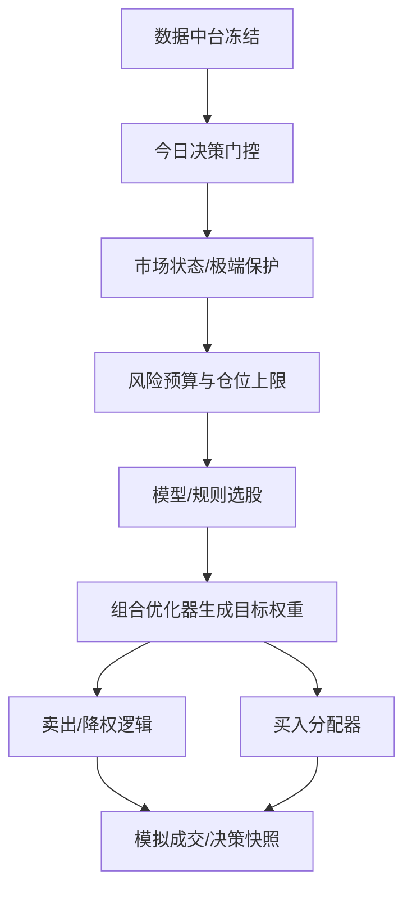
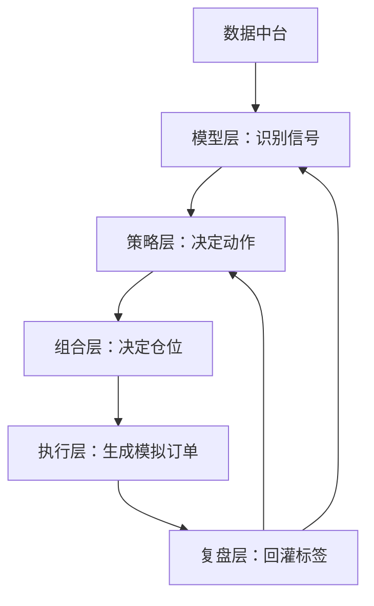
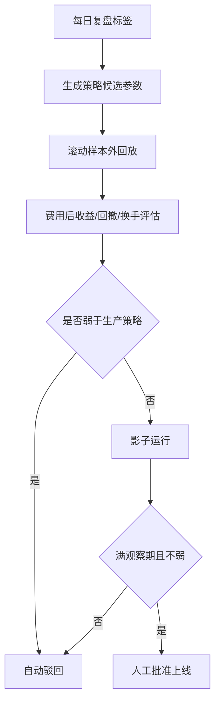

# 策略层重构计划：从固定调仓管线到统一策略大脑

> 目标：把当前分散在模型治理、决策门控、组合优化、卖出诊断、买入分配器里的调仓逻辑，收敛成一个统一的 `StrategyController`。系统负责根据模型和行情生成动作，人只审批策略/模型上线，不参与日常“研究填空”。

## 1. 当前问题

当前系统已经有数据中台、模型训练、风险门控、组合优化和模拟执行，但“策略”本身还不是一个独立模块。

现在的真实链路是：



主要问题：

1. **没有统一策略总控器**：买入、卖出、仓位、风险收缩、模型信号分散在多个模块。
2. **模型作用不够硬**：资金、龙头、事件、叙事模型更多是证据/治理，尚未完全成为调仓主链路输入。
3. **策略参数偏写死**：仓位目标、阈值、加减仓规则、换手限制主要由代码常量和规则控制。
4. **调仓动作缺少统一合同**：每个动作没有统一记录触发模型、收益来源、持有周期、退出条件、禁止条件。
5. **自优化只到模型层**：目前能自动训练/筛弱模型，但还不能优化策略参数或策略版本。

## 2. 目标架构

重构后的系统分为五层：



### 2.1 模型层：回答“发生了什么”

模型层只输出信号，不直接决定仓位：

| 模型 | 职责 | 输出 |
| --- | --- | --- |
| `medium_horizon_lambdarank_v1` | 中期景气排序 | 股票排序、相对收益桶 |
| `capital_persistence_multitask_v1` | 资金确认 | 资金持续性、加仓/减仓门 |
| `leader_lambdarank_v1` | 龙头识别 | 主线内部龙头分数 |
| `event_surprise_lgbm_v1` | 事件预期差 | 事件胜率、预期差方向 |
| `narrative_transition_multitask_v1` | 叙事生命周期 | 启动/发酵/高潮/衰退、退出信号 |
| `portfolio_risk_engine_v1` | 风险预算 | 总仓位、单票、行业、相关性约束 |

### 2.2 策略层：回答“该怎么做”

新增 `StrategyController`，统一把模型输出转成动作：

- `buy_candidate`：纳入买入候选
- `add_position`：加仓
- `reduce_position`：减仓
- `sell_exit`：退出
- `hold`：继续持有
- `defensive_switch`：切换防御资产

每个动作必须生成 `StrategyActionContract`：

```json
{
  "symbol": "600000",
  "action": "add_position",
  "trigger_models": ["medium_horizon_lambdarank_v1", "capital_persistence_multitask_v1"],
  "expected_return_source": "中期景气改善 + 资金持续确认",
  "holding_period": "20-60 sessions",
  "narrative_lifecycle": "confirmed",
  "capital_confirmation": "passed",
  "risk_budget": { "max_weight": 0.08, "target_weight_hint": 0.05 },
  "exit_conditions": ["资金撤退", "叙事衰退", "模型排名跌出阈值", "组合风险收缩"],
  "forbidden_conditions": ["涨停不可买", "停牌", "数据未冻结", "行业超限"],
  "data_status": "frozen"
}
```

### 2.3 组合层：回答“买多少”

组合优化器不再决定策略方向，只接收策略层输出的目标候选和动作约束：

- 预期收益：来自模型层与策略动作合同
- 风险：波动、相关性、CVaR、最大回撤贡献
- 成本：佣金、滑点、印花税、换手预算
- 限制：总仓位、单票、行业、相关行业、流动性容量

输出：

- `target_weights`
- `weight_change_plan`
- `risk_budget_usage`
- `why_this_weight`

### 2.4 执行层：回答“能不能成交”

执行层只做交易约束和模拟成交：

- T+1
- 涨跌停
- 停牌
- 一手限制
- 现金不足
- 滑点和费用
- ETF/股票费用差异

执行层不得改变策略意图，只能返回成交、部分成交或拦截原因。

### 2.5 复盘层：回答“学到了什么”

每次模拟交易后生成标签：

- 赚钱来自模型排序、行业暴露、仓位、择时还是防御资产
- 亏损来自模型失效、风险预算错误、叙事结束、资金撤退、执行成本还是不可交易
- 是否违反买入预期
- 是否触发退出条件

这些标签回灌到：

- 模型训练集
- 策略参数评估
- 自优化候选策略版本

## 3. 新增核心模型族：策略版本

新增策略版本表/产物，不直接改代码常量：

```json
{
  "strategy_key": "rebalance_strategy_controller_v1",
  "version": "20260721_01",
  "status": "candidate",
  "market_state_policy": {
    "risk_expansion": { "max_equity": 0.90, "max_single": 0.15 },
    "sideways": { "max_equity": 0.65, "max_single": 0.10 },
    "risk_contraction": { "max_equity": 0.40, "max_single": 0.06 },
    "stress": { "max_equity": 0.25, "max_single": 0.04 }
  },
  "signal_thresholds": {
    "rank_min_percentile": 0.85,
    "capital_confirm_min": 0.60,
    "leader_min_score": 0.65,
    "event_win_prob_min": 0.58,
    "narrative_exit_prob": 0.65
  },
  "rebalance_rules": {
    "min_weight_change": 0.015,
    "max_monthly_turnover": 0.30,
    "loss_review_threshold": -0.06,
    "profit_trim_threshold": 0.25
  }
}
```

## 4. 自优化升级方向

当前自优化是“模型层自优化”：

- 自动训练 challenger
- 自动比较指标
- 自动驳回弱候选
- 人工批准上线

下一阶段升级成“模型 + 策略双层自优化”：



自优化允许自动改：

- 市场状态下仓位上限
- 排序分数阈值
- 资金确认阈值
- 加仓/减仓阈值
- 叙事退出阈值
- 换手预算
- 防御资产切换阈值

自优化不允许自动改：

- 直接实盘下单权限
- 最大账户风险红线
- 数据未冻结时交易
- 人工批准门槛

## 5. 实施计划

### P0：冻结当前真实链路

目标：先把当前调仓链路完整显性化，不再“散落在代码里”。

任务：

1. 输出 `rebalance_decision_trace`：记录数据、模型、风险、策略、组合、执行每一步输入输出。
2. 在前端今日调仓页展示“系统为什么这么做”。
3. 标记当前所有写死参数来源。

验收：

- 用户能看到：今天为什么买、为什么卖、为什么不动、为什么降风险。
- 每个调仓动作都能追溯到模型/规则/风险来源。

### P1：新增 `StrategyController`

目标：把买入、卖出、加仓、减仓、防御切换统一到一个策略控制器。

任务：

1. 新增 `backend/app/services/strategy_controller.py`。
2. 定义 `StrategyActionContract`。
3. 接入五个计划书模型输出。
4. 输出统一动作列表，替代散落的买卖判断。

验收：

- 所有买卖动作都来自 `StrategyController`。
- 每个动作都有收益来源、持有周期、退出条件、风险预算和数据状态。

### P2：组合优化器降级为“仓位执行器”

目标：组合优化器只负责权重，不负责策略方向。

任务：

1. `quant_run_engine` 接收 `StrategyActionContract`。
2. CVaR/HRP/Black-Litterman 只在候选动作集合内分权重。
3. 目标权重必须解释为“策略动作 + 风险预算 + 优化约束”的结果。

验收：

- 权重变化都有可读原因。
- 不再出现“策略说风险收缩，但执行链路又尽量全仓”的冲突。

### P3：卖出逻辑产品化

目标：卖出不再只是规则散点，而是策略动作的一部分。

卖出来源：

- 模型失效卖
- 风险压缩卖
- 叙事结束卖
- 资金撤退卖
- 估值/涨幅透支卖
- 不在目标池卖

验收：

- 每笔卖出都有 `sell_exit` 或 `reduce_position` 合同。
- 前端能一眼看到“卖出原因排序”。

### P4：策略版本管理

目标：策略参数和模型一样可版本化、可回退、可审批。

任务：

1. 新增策略版本存储。
2. 记录参数、训练/回放区间、费用后指标、上线状态。
3. 前端模型治理合并展示“模型版本 + 策略版本”。

验收：

- 每个策略版本只展示生产版和前两个版本。
- 支持回退。
- 弱候选自动驳回。

### P5：策略自优化

目标：系统自动提出策略参数候选，人只批准强候选。

任务：

1. 基于复盘标签生成候选参数。
2. 做 walk-forward、purge、embargo、费用后回放。
3. 新策略不如旧策略自动驳回。
4. 强候选进入人工审批。

验收：

- 策略自优化不会制造重复版本。
- 人工只看到“指标比生产版更好”的候选。

## 6. 前端重构原则

前端不展示“研究材料堆”，只展示系统结论：

首页只回答四个问题：

1. 今天是否调仓？
2. 如果调仓，买/卖什么？
3. 预期收益来自哪里？
4. 最大风险和退出条件是什么？

模型治理页只回答：

1. 模型是否可用？
2. 策略是否可用？
3. 有无候选需要人工批准？
4. 候选是否比生产版更好？

组合与调仓页只回答：

1. 当前组合离目标组合差多少？
2. 哪些持仓需要加/减/卖？
3. 交易约束是否允许执行？
4. 执行后仓位和风险会变成什么？

## 7. 风险红线

无论策略如何自优化，以下规则不能被自动突破：

- 数据未冻结不交易。
- 无生产模型不新增风险。
- 组合硬约束不允许扩张风险敞口。
- 单票、行业、相关行业、流动性容量必须硬约束。
- 费用后回放不通过不得上线。
- 策略候选弱于生产策略必须自动驳回。
- 当前项目不做实盘自动下单。

## 8. 第一阶段建议落地顺序

建议先做这 4 个最关键动作：

1. 新增 `StrategyActionContract` 数据结构。
2. 新增 `StrategyController`，先接管当前规则，不改变交易结果。
3. 给每笔调仓动作补全“模型来源 + 策略原因 + 退出条件”。
4. 前端今日调仓页改成策略总控视图。

这样风险最低：先不改变实际交易行为，只把“现在为什么这么调仓”收拢成一个可审计、可优化的策略层。

## 9. 当前后端落地状态（2026-07-21）

### P0：已落地

- `quant_run_engine` 已输出 `rebalance_decision_trace`、`strategy_controller`、`strategy_action_contracts`。
- 每笔动作能追溯数据状态、模型来源、策略原因、组合约束和执行约束。
- 剩余前端展示属于下一阶段，不计入本轮后端验收。

### P1：已落地

- 已新增 `backend/app/services/strategy_controller.py`。
- 已定义 `StrategyActionContract`。
- 买入、卖出、持有、拦截统一生成动作合同。
- 计划书模型以 `trigger_models` 和证据字段接入策略动作；真实模型训练质量属于模型训练积累，不在本轮“后端设计”范围内。

### P2：后端第一版已落地

- `StrategyController` 先生成买/卖/持有动作。
- 组合优化器只在目标池和风险预算约束内生成权重。
- `portfolio_risk.role_contract` 明确记录：策略层负责方向，组合层负责权重，执行层负责模拟成交约束。
- 已新增 `target_weight_explanations`，逐票解释目标权重来自策略信号、风险预算、组合约束、样本数量、流动性容量和优化器。
- 已把防御资产补位升级为正式 `defensive_switch` 动作合同，不再只是组合层隐含买入。
- 为了遵守当前项目“非实盘 + 尽量满仓 + 防御资产补位”的既有红线，暂未强行取消全仓约束；后续如要改变收益/风险偏好，应作为策略版本候选评估后上线。

### P3：已落地

- 卖出/减仓诊断已收敛到策略层。
- 支持 `out_of_target_pool`、`risk_budget_shrink`、`loss_exceeds_expected`、`thesis_invalidated`、`model_decay`、`valuation_overextension`。
- 每笔卖出生成 `sell_exit` 或 `reduce_position` 合同。

### P4：已落地

- 策略参数复用 `model_versions` 统一治理，`model_key = strategy_controller`。
- 支持默认生产策略、候选策略、人工批准/驳回、弱候选自动拦截。
- 已新增策略回退接口：`POST /api/model-strategy/strategy-controller/rollback/{version_id}`。
- 状态接口只返回当前生产版和前两个版本，避免版本列表堆积。

### P5：后端第一版已落地，时间积累项除外

- 已新增策略自优化接口：`POST /api/model-strategy/strategy-controller/auto-optimize`。
- 已新增策略回放预览接口：`POST /api/model-strategy/strategy-controller/replay-preview`。
- 自优化会生成有限、可解释、带边界的参数候选，并自动评估。
- 重复候选不会反复创建。
- 越界候选自动拒绝；成熟复盘样本不足时标记 `blocked_by_data`，不会伪装成通过。
- 当前验证方法是 `strategy_policy_cost_after_decision_outcome_proxy_v1`，回放预览方法是 `decision_snapshot_replay_preview_v1`；两者都不会自动上线。
- 完整逐日重建、严格 purge / embargo、20-session 影子观察仍属于时间与样本积累项。

### 后端接口清单

- `GET /api/model-strategy/strategy-controller`
- `POST /api/model-strategy/strategy-controller/candidates`
- `POST /api/model-strategy/strategy-controller/validate/{version_id}`
- `POST /api/model-strategy/strategy-controller/review/{version_id}`
- `POST /api/model-strategy/strategy-controller/rollback/{version_id}`
- `POST /api/model-strategy/strategy-controller/auto-optimize`
- `POST /api/model-strategy/strategy-controller/replay-preview`
